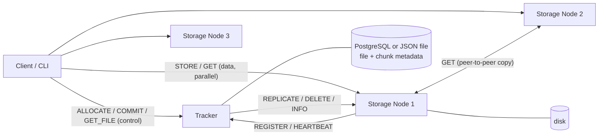
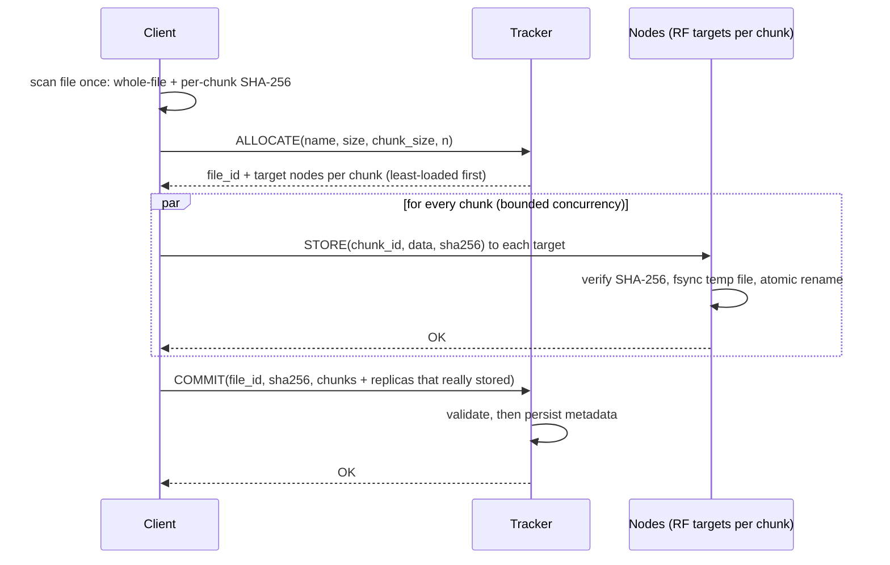
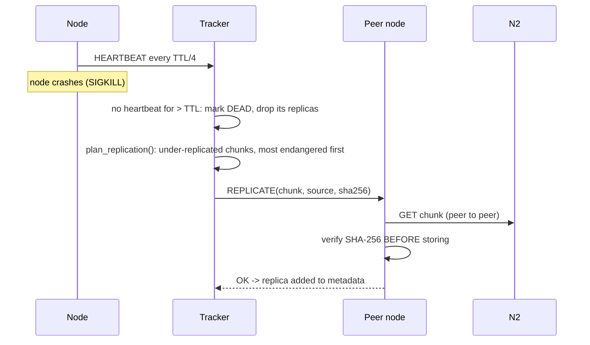

# VektorFS Architecture

VektorFS is a fault-tolerant distributed file system. Files are split into
chunks, each chunk is replicated on several storage nodes, and SHA-256 hashes
verify integrity end to end. Everything runs on `asyncio` + a custom framed TCP
protocol; the runtime has no third-party dependencies (PostgreSQL support is an
optional extra).

## Components

| Component | Module | Responsibility |
|---|---|---|
| Wire format | `common/protocol.py` | 4-byte length + JSON frame, 16 MiB cap |
| Message contract | `common/messages.py`, `common/tracker_messages.py` | builders + validating parsers: the single source of truth for message shapes |
| One-shot RPC | `common/rpc.py` | connect/send/receive under one timeout |
| Chunking/hashing | `common/chunking.py`, `common/hashing.py` | one-pass scan, per-chunk + whole-file SHA-256, bounded memory |
| Storage manager | `node/storage.py` | disk only: atomic writes, path-traversal protection |
| Storage node server | `node/server.py` | sockets -> validated request -> StorageManager |
| Tracker agent | `node/agent.py` | register (with chunk report), heartbeat, re-register |
| Cluster state | `tracker/state.py` | *pure logic*, no sockets/sleeps: placement, membership, repair planning |
| Tracker server | `tracker/server.py` | sockets, failure detector, replication + scrub loops |
| Metadata stores | `tracker/store.py` | JSON-file or PostgreSQL persistence |
| Client | `client/client.py`, `client/cli.py` | upload/download/verify/retry |

Layering rule used everywhere: **networking never contains storage or
decision logic**, and decision logic never touches a socket. That is why
`StorageManager` and `ClusterState` are unit-tested without any network.

## Upload

* A chunk with **at least one** stored replica commits; the tracker's
  re-replication loop raises it to RF afterwards (availability over strictness).
* If any chunk has *zero* stored replicas the upload fails and the client
  deletes what it already wrote and sends `ABORT` (no orphans, no phantom load).
* The client never trusts a node: it re-hashes each chunk as it reads it from
  disk and aborts if the source file changed mid-upload.

## Download

The client asks the tracker for the chunk list + replica locations, then
fetches chunks **in parallel from randomly chosen replicas**. Each chunk is
checked for size and SHA-256. A bad or unreachable replica is skipped (and
corrupt ones are reported via `REPORT_CORRUPT`); if every known replica fails,
the replica list is refreshed from the tracker and retried. The file is written
to `<dest>.part`, whole-file SHA-256 is verified, and only then renamed into
place, so a failed download never leaves a plausible-looking partial file.

## Failure detection and recovery

* A returning node re-registers with a **chunk report**; the tracker rebuilds
  its replica locations from that report and tells the node to delete orphans
  (chunks of files deleted while it was away).
* A tracker restart loses only replica *locations*; nodes get `UNKNOWN_NODE` on
  their next heartbeat and re-register, which rebuilds them.
* Replication is bounded (`max_parallel_replications`) and de-duplicated
  (`(chunk, target)` in-flight set) so a node failure cannot stampede the cluster.

## Integrity layers

| Layer | Where | Catches |
|---|---|---|
| Transit | node verifies `sha256` on `STORE` | damage on the wire / lying sender |
| Replication | target verifies against the tracker-recorded hash before storing | copying a rotten replica onto a healthy node |
| Read | client verifies every chunk + whole file | any bad replica; never returns bad data |
| At rest | tracker **scrubber** (`SCRUB` / `--scrub-interval`) asks nodes for the hash of what is *on disk* | silent bit rot on replicas nobody has read |
| Atomicity | node writes temp + fsync + `os.replace` | torn writes after a crash |

## Metadata

Only file -> chunks (id, index, size, SHA-256) is persisted. Replica locations are
rebuilt from node reports, because nodes know what is really on their disks.
Back ends: JSON file (default, atomic snapshots) or PostgreSQL (`files` +
`chunks` tables, one transaction per commit/delete). Writes run in a worker
thread under a single FIFO lock so they never block the event loop and land in
mutation order. A commit that cannot be made durable is rolled back; a delete is
persisted *before* it takes effect, so a failed write never resurrects a file.
