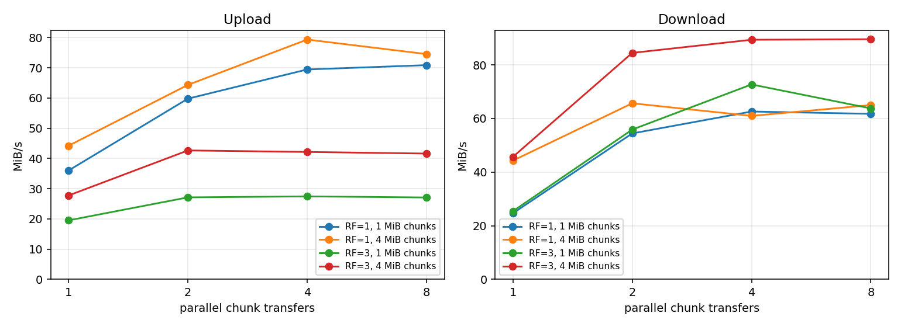
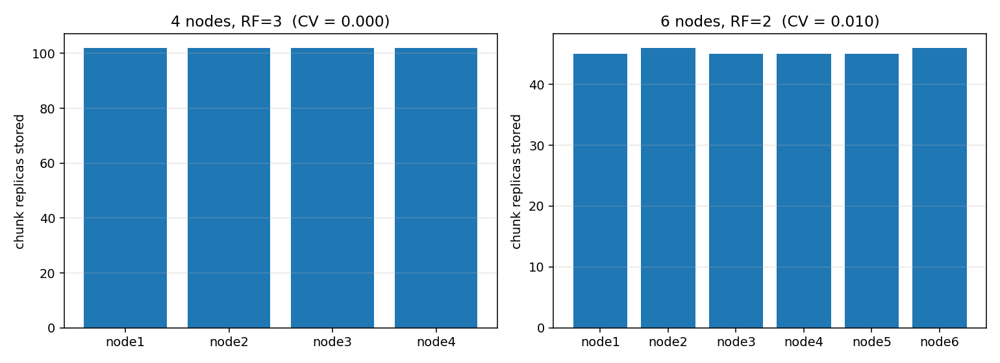
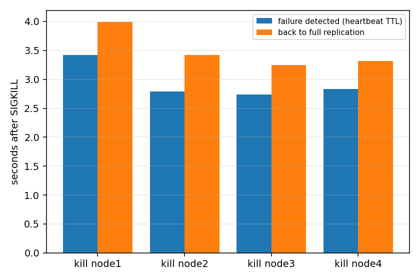

# Evaluation

Reproduce: `python -m benchmarks.bench all` then `python -m benchmarks.plot`
(raw CSVs and PNGs are in `benchmarks/results/`).

**Test bed:** Windows, Python 3.12.6, loopback TCP, 1 tracker + 4 storage-node
*processes* plus the client on one machine. Hardware: **<Intel Core i5-12450H, 8 cores, 16GB, 512GB NVMe SSD>**.
Everything shares one machine and a loopback network, so absolute MiB/s numbers show
how the *software* behaves, not what a real multi-host network would deliver.

## 1. Transfer performance (64 MiB file, 4 nodes, mean of 3 runs)

| RF | chunk | parallel transfers | upload MiB/s | download MiB/s |
|---|---|---|---|---|
| 1 | 1 MiB | 1 / 2 / 4 / 8 | 36.0 / 59.8 / 69.5 / 70.9 | 24.7 / 54.4 / 62.6 / 61.7 |
| 1 | 4 MiB | 1 / 2 / 4 / 8 | 44.2 / 64.4 / 79.4 / 74.6 | 44.3 / 65.7 / 61.0 / 65.0 |
| 3 | 1 MiB | 1 / 2 / 4 / 8 | 19.5 / 27.1 / 27.5 / 27.1 | 25.4 / 55.9 / 72.7 / 63.8 |
| 3 | 4 MiB | 1 / 2 / 4 / 8 | 27.8 / 42.7 / 42.2 / 41.6 | 45.7 / 84.5 / 89.4 / 89.6 |

Mean of 3 repetitions per cell. Run-to-run spread was larger than in earlier passes
(up to ~15 MiB/s on some single-transfer cells), consistent with other processes briefly
competing for the CPU on a general-purpose machine rather than a dedicated benchmark
rig. At `concurrency=1, chunk=4 MiB` both RF=1 and RF=3 showed a clear warm-up effect
across the three reps (e.g. RF=1: 33.7 -> 45.6 -> 53.4 MiB/s), most likely OS disk-cache
or TCP-connection warm-up rather than anything in VektorFS; it is visible here rather
than smoothed away.

What the data supports:

* **Parallel chunk transfer works.** Going from 1 to 4 concurrent transfers roughly
  doubled RF=1 upload (36.0 -> 69.5 MiB/s, 1 MiB chunks) and more than doubled downloads
  (24.7 -> 62.6 with RF=1; 25.4 -> 72.7 with RF=3). An identical experiment on a single-core
  sandbox earlier showed almost no speed-up, which indicates the gain comes from using
  several cores/connections at once rather than from the protocol alone.
* **Diminishing or negative returns beyond 4 transfers**: several cells are flat or dip
  slightly from 4 to 8 (e.g. RF=1, 1 MiB upload: 69.5 -> 70.9, essentially flat; RF=1,
  4 MiB download: 61.0 -> 65.0, within run-to-run noise). The client process and machine
  are saturating; we did not profile the exact bottleneck, but the client's Python-level
  JSON/base64/SHA-256 work is a likely contributor.
* **Replication costs upload bandwidth.** RF=3 uploads plateau around 27-43 MiB/s versus
  60-79 MiB/s for RF=1 (roughly 0.5-0.6x at higher concurrency), because the client sends
  each chunk to three nodes. Downloads are largely unaffected by RF, since a chunk is read
  from a single replica.
* **Larger chunks help most at low concurrency** (RF=1, 1 transfer: 24.7 vs 44.3 MiB/s
  download for 1 MiB vs 4 MiB chunks - fewer round trips), and the gap narrows once enough
  transfers run in parallel.

## 2. Storage distribution

| Cluster | chunk replicas per node | coefficient of variation |
|---|---|---|
| 4 nodes, RF=3 (40 files, 136 chunks = 408 replicas) | 102 / 102 / 102 / 102 | 0.000 |
| 6 nodes, RF=2 (same 40 files = 272 replicas) | 46 / 45 / 46 / 45 / 45 / 45 | 0.010 |

Least-loaded placement with random tie-breaking keeps nodes within one chunk of each other.

## 3. Node failure and recovery (64 MiB, 64 chunks, RF=3, TTL=3 s, hard kill, 4 trials)

| Metric | Result |
|---|---|
| Download **during** the outage, before detection | succeeded and SHA-256 verified in **4/4** trials |
| Time from kill to node declared DEAD | **2.7-3.4 s** (TTL 3 s + detector polling) |
| Time from kill to every chunk back at 3 copies | **3.2-4.0 s** (about 0.4-0.6 s of re-replication after detection) |

| Trial | Node killed | Detected (s) | Fully re-replicated (s) |
|---|---|---|---|
| 1 | node1 | 3.4 | 4.0 |
| 2 | node2 | 2.8 | 3.4 |
| 3 | node3 | 2.7 | 3.2 |
| 4 | node4 | 2.8 | 3.3 |

Detection time is governed by the TTL, so it is a tunable trade-off (shorter =
faster recovery but more false positives on a loaded node). Detection and healing are timed by a
watcher running *concurrently* with the during-outage download, so slow reads cannot distort them.

## 4. Data integrity (16 MiB, 16 chunks, RF=3)

| Scenario | Outcome |
|---|---|
| Scrubber: one replica of **every** chunk silently corrupted on disk | all detected; cluster back to RF=3 in **0.8 s**, no client involved |
| Client read: one replica of every chunk corrupted | download correct (SHA-256 verified), bad replicas skipped and reported |
| **All** replicas of one chunk corrupted | download **fails with an error**, no output file - bad data is never returned |

Finding worth noting: the read path only notices corruption on the replicas it
happens to read (replica choice is random), so some bad copies survive a
download unreported. The scrubber exists precisely to find those.

## Limits of this evaluation

Single machine, loopback network, one file size, 3 repetitions per throughput cell. No
network-latency, multi-host or large-scale (hundreds of nodes) testing was done.